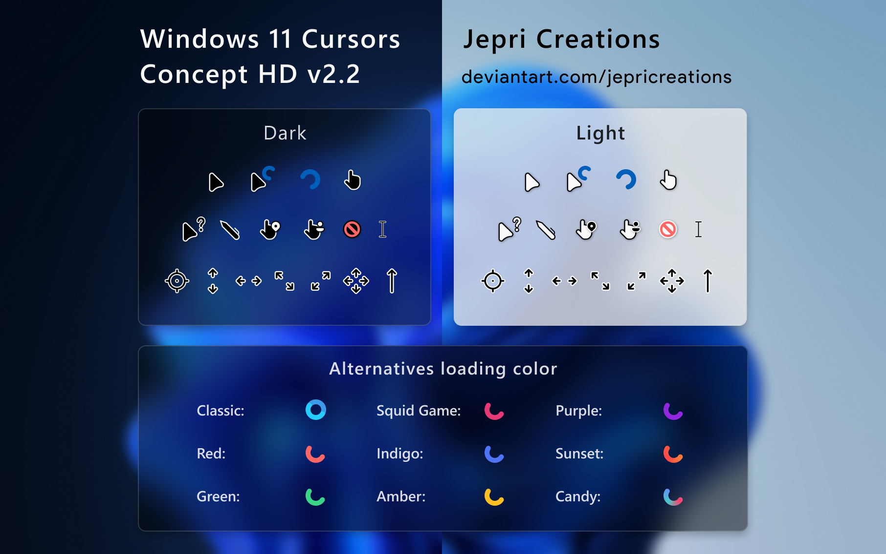
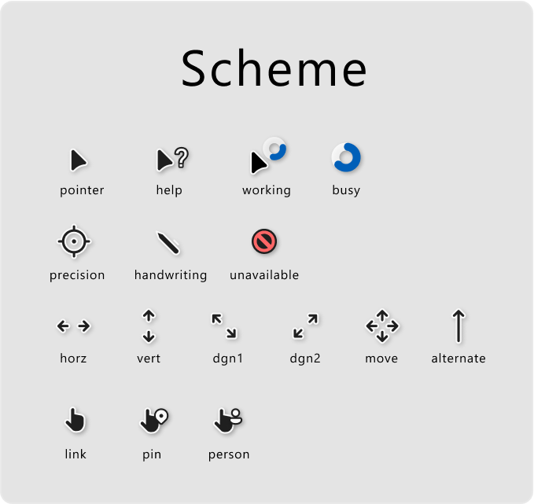

# Windows 端光标方案




Windows 11 Cursor Concept **HD v2.2**（原作者 Jepri Creations）的原始 .cur / .ani 文件。

## 目录结构

```
win/
├── README.md      ← 本文件
├── install.cmd    ← 一键安装脚本（管理员权限）
├── Scheme.png     ← 10 种 spinner 配色总览
├── Preview.jpg    ← 光标外观预览
├── dark/          ← 深色底用
│   ├── regular/   ← 抗锯齿高清版（推荐）
│   │   ├── base/                ← 15 个静态 .cur
│   │   ├── 01_default/          ← busy.ani + working.ani（默认蓝色）
│   │   ├── 02_classic/
│   │   ├── 03_amber/
│   │   ├── 04_green/
│   │   ├── 05_indigo/
│   │   ├── 06_red/
│   │   ├── 07_squid/
│   │   ├── 08_purple/
│   │   ├── 09_candy/
│   │   ├── 10_sunset/
│   │   ├── alternatives/         ← 额外的静态光标（如 precision.cur）
│   │   └── dark purple - pippouz request/
│   └── small/     ← 像素风版，目录结构同上
└── light/         ← 浅色底用，目录结构同上
```

* `base/` 里是所有配色共享的 15 个静态光标（pointer、text 横线、crosshair、link、move、八向缩放箭头、hand、person、pin、unavailable…）。
* `01_default/` … `10_sunset/` 每个目录只放 `busy.ani` 和 `working.ani`，即加载动画；其余 15 个静态光标走 `base/`。颜色对应关系见 [Scheme.png](Scheme.png)。
* `regular/` 和 `small/` 的差别是静态光标和 `working` 的细节风格，按个人喜好挑一个用。

## 安装

### 方法 1：一键脚本（推荐）

**右键 `install.cmd` → 以管理员身份运行**。

默认会装全部 20 个配色方案（dark + light × 10 配色）。脚本对每个 `dark/<regular|small>/<NN_colour>/Install.inf` 调一次 `setupapi.dll` 的 `DefaultInstall` 节，完成：
1. 把 `base/*.cur` 与当前配色的 `busy.ani` / `working.ani` 拷贝到 `%SystemRoot%\Cursors\<方案名>\`
2. 写入注册表，把当前方案注册到 Windows 光标方案列表里

可选参数：
```cmd
install.cmd            REM 全部 20 个（默认）
install.cmd dark       REM 只装深色 10 个
install.cmd light      REM 只装浅色 10 个
```

参考实现来自上游 `Windows-11-Cursor-Concept-Pro-v2.0\Install_Alt_Run-As-Admin.cmd`，但改为自动化遍历本仓库所有 Install.inf，不需要联网下载，也不再需要手动挑选颜色。

安装完后到 **设置 → 个性化 → 主题 → 鼠标光标**，在"方案"下拉里挑一个形如 `W11 Cursors Dark HDPI default by Jepri Creations` 的方案应用。

### 方法 2：手动右键 Install.inf

挑一个颜色方案（例如 `dark/regular/01_default/`），**右键 `Install.inf` → 安装**。一次只注册一个方案，但更直观。

如果右键菜单里的"安装"无效（极少见，权限问题），可以以管理员身份打开 PowerShell 跳到该目录：

```powershell
rundll32.exe setupapi.dll,InstallHinfSection DefaultInstall 132 .\Install.inf
```

## 自定义 / 二次处理

`base/*.cur` 可以直接用 RealWorld Cursor Editor 等工具打开做修改。`.ani` 是标准 RIFF/ACON 容器，可用 ImageMagick 拆帧：

```powershell
magick busy.ani[0] busy_frame0.png
```

`regular/` 和 `small/` 的差异是渲染风格——两种都用同一套 base 文件即可重新做高 DPI 适配。